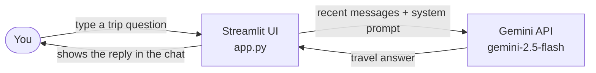

# GemiQuest ✨

GemiQuest is a chatty little travel guide that lives in your browser. Ask it where to go, what to eat, or how to fill three days in a city you've never seen, and it answers with imagination and practical tips, powered by Google's Gemini API. It's for anyone who'd rather brainstorm a trip in conversation than in twenty browser tabs, and it's small enough to read, run, and tinker with in an afternoon.

## Visuals

<!-- TODO (Kat): capture the app with a short conversation on screen (title, one question, one answer) and save it as docs/screenshot.png -->


<!-- TODO (Kat): record a 10–20 second GIF of typing a trip question, the "GemiQuest is thinking..." spinner, and the reply appearing. Save it as docs/demo.gif -->


### How it works



## Features

- **Chat-style trip planning.** Type a question in the chat box and GemiQuest answers as a creative, talkative travel guide.
- **Remembers the recent conversation.** Your last few messages are sent along with each question, so follow-ups like "what about in winter?" make sense.
- **Automatic retries and a backup model.** If Gemini has a server hiccup, the app retries up to 3 times, then falls back to the lighter `gemini-2.5-flash-lite` model.
- **Friendly error messages.** You see a plain-language note in the chat instead of a raw stack trace. The technical details go to your terminal.
- **Two ways to supply your API key.** Use a `.env` file or `.streamlit/secrets.toml`, whichever you prefer.
- **Custom pastel look.** A travel-icon avatar and custom styling from `style.css`, with the light theme locked in so it stays readable.

## Prerequisites

Before you start, you'll need:

- **Python 3.10 or newer.** The project was built on Python 3.13.
- **macOS, Linux, or Windows.** There's nothing OS-specific here; only the virtual environment commands differ, and both are shown below.
- **Git**, to clone the repo.
- **A Google Gemini API key.** Get one for free at [Google AI Studio](https://aistudio.google.com/apikey).
- **An internet connection**, since every answer comes from the Gemini API.

The app looks for your key under the exact name **`API_KEY`**. It checks `.streamlit/secrets.toml` first, then environment variables and your `.env` file.

## Installation

**1. Clone the repo and step into it**

```bash
git clone https://github.com/katkay1997/GemiQuest-Bot.git
cd GemiQuest-Bot
```

**2. Create and activate a virtual environment**

macOS / Linux:

```bash
python3 -m venv .venv
source .venv/bin/activate
```

Windows (PowerShell):

```powershell
python -m venv .venv
.venv\Scripts\Activate.ps1
```

Windows (Command Prompt):

```bat
python -m venv .venv
.venv\Scripts\activate.bat
```

You'll know it worked when `(.venv)` appears at the start of your terminal prompt.

**3. Install the dependencies**

```bash
pip install -r requirements.txt
```

**4. Add your API key**

Pick **one** of these two options. Both files are already listed in `.gitignore`, so your key won't be committed by accident.

Option A: create a file named `.env` in the project folder:

```bash
API_KEY=AIzaSy-this-is-a-fake-example-key
```

Option B: create a file named `secrets.toml` inside the `.streamlit` folder:

```toml
API_KEY = "AIzaSy-this-is-a-fake-example-key"
```

Swap the fake key for your real one. Never paste a real key into code, a screenshot, or a commit.

**5. (Optional) Check that your key works**

If you used the `.env` option, this quick script confirms Gemini accepts your key:

```bash
python test_the_key.py
```

A line starting with `✅ Success!` means you're ready to go.

## Quick Start

From the project folder, with your virtual environment active, run:

```bash
streamlit run app.py
```

Your browser should open to **http://localhost:8501**. If it doesn't, paste that address in yourself.

Then try asking:

- "Plan a 3-day food-focused weekend in Lisbon on a budget."
- "I have 10 days in Japan in April. What route would you suggest?"
- "What should I pack for a week of hiking in Patagonia?"

To stop the app, press `Ctrl+C` in the terminal.

## Limitations

A few honest caveats before you book anything:

- **Rate limits and quotas.** The Gemini API limits how many requests you can make, and the free tier is especially tight. When you hit the cap, GemiQuest tells you it has "used up its travel budget" and you'll need to wait. See Google's [rate limits page](https://ai.google.dev/gemini-api/docs/rate-limits) for the current numbers.
- **Chat history isn't saved.** Your conversation lives only in the open browser tab. Refresh the page or restart the app and it's gone.
- **Short memory.** Only your 6 most recent messages are sent to Gemini, so it will lose track of details from earlier in a long chat.
- **Needs the internet.** There's no offline mode.
- **Travel info can be wrong or out of date.** GemiQuest doesn't look anything up live. Prices, opening hours, visa rules, and safety advice can be outdated or simply made up, so always double-check with official sources before you rely on them.
- **Text only.** No maps, bookings, images, or file uploads.

## Troubleshooting

When something goes wrong, GemiQuest shows a friendly message in the chat and prints the real error in the terminal where you ran `streamlit run app.py`. Look there first.

| What you see | What's likely wrong | How to fix it |
| --- | --- | --- |
| "GemiQuest can't find its travel pass 🔑" | No API key was found. | Make sure your `.env` or `.streamlit/secrets.toml` exists, the name is exactly `API_KEY`, and you restarted the app after adding it. |
| "GemiQuest couldn't quite read that map 🗺️" on every message, with `API key not valid` in the terminal | Your key is invalid, mistyped, or revoked. | Copy a fresh key from [Google AI Studio](https://aistudio.google.com/apikey), check for stray spaces or quotes, and restart. Run `python test_the_key.py` to confirm. |
| "GemiQuest couldn't quite read that map 🗺️", with a `404` or `not found` error in the terminal | The model name isn't available to your key (Google retires models over time). | Open `app.py` and update `MODEL_ID` and `FALLBACK_MODEL_ID` to models listed in the [Gemini models docs](https://ai.google.dev/gemini-api/docs/models). |
| "GemiQuest has used up its travel budget 🧳", with a `429` in the terminal | You hit a rate limit or your quota. | Wait a minute and try again. If it keeps happening, check your usage in Google AI Studio. |
| "GemiQuest is a little overwhelmed right now ✨" | Gemini's servers were unavailable even after retries and the backup model, or your connection dropped. | Check your internet, then try again in a minute. |
| `ModuleNotFoundError: No module named 'streamlit'` (or `google`, `dotenv`) | Dependencies aren't installed in the environment you're using. | Activate your virtual environment, then run `pip install -r requirements.txt` again. |
| `streamlit: command not found` | The virtual environment isn't active. | Activate it (see Installation, step 2) and retry. |
| The app runs but looks plain, or the avatar is missing | You launched it from a different folder, so `style.css` and `assets/` weren't found. | `cd` into the project folder first, then run `streamlit run app.py`. |

Still stuck? Run this to confirm Streamlit itself is healthy:

```bash
streamlit run check_streamlit.py
```

## Roadmap

Ideas for later (nothing here is built yet):

- [ ] Save chat history between sessions
- [ ] Streamed, word-by-word replies
- [ ] Export an itinerary to a file
- [ ] _Your idea here_
- [ ] _Your idea here_

## Contributing

Suggestions and pull requests are welcome. For anything bigger than a small fix, please open an issue first so we can talk it through. Please never include a real API key in an issue, a commit, or a screenshot.

## License

<!-- TODO (Kat): no LICENSE file exists yet. Pick a license (MIT is a common choice), add a LICENSE file, and update this section. -->
No license has been chosen yet. Until one is added, all rights are reserved by the author.

## Author

Made by Kat · GitHub: [@katkay1997](https://github.com/katkay1997)
