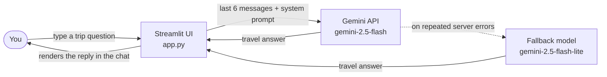

# GemiQuest ✨

**An AI travel guide you can chat with, built on Streamlit and Google Gemini.**


[](https://kat-gemigenie.streamlit.app/)

## Overview

GemiQuest is a conversational travel guide that runs in your browser. Ask where to go, what to eat, or how to spend three days in an unfamiliar city, and it replies with creative ideas and practical tips generated by Google's Gemini API. It's built for travelers who would rather brainstorm a trip in one conversation than across twenty browser tabs, and the codebase is small enough to read, run, and extend in an afternoon.

## Demo

**Live app:** [kat-gemigenie.streamlit.app](https://kat-gemigenie.streamlit.app/)

<!-- TODO (Kat): capture the app with a short conversation on screen (title, one question, one answer) and save it as docs/screenshot.png -->


<!-- TODO (Kat): record a 10–20 second GIF of typing a trip question, the "GemiQuest is thinking..." spinner, and the reply appearing. Save it as docs/demo.gif -->


### How it works



## Features

### Conversation
- **Chat-style trip planning:** ask anything in the chat box; GemiQuest answers in character as a creative, talkative travel guide (set via a Gemini system instruction).
- **Short-term memory:** the 6 most recent messages are sent with each request, so follow-ups like "what about in winter?" keep their context.
- **Live feedback:** a "GemiQuest is thinking..." spinner shows while Gemini generates a reply.

### Reliability
- **Retries with exponential backoff:** Gemini server errors (5xx) are retried up to 3 times with backoff plus random jitter.
- **Automatic model fallback:** if `gemini-2.5-flash` stays unavailable, the app switches to the lighter `gemini-2.5-flash-lite`.
- **Friendly error handling:** quota limits (429), bad requests, empty responses, and outages each get their own plain-language chat message. Full technical details are logged to the terminal, and error messages are kept out of the chat history sent back to Gemini.

### Configuration & UI
- **Flexible API key loading:** reads `API_KEY` from Streamlit secrets first, then from environment variables or a `.env` file.
- **Custom pastel theme:** a tropical-sunset look from `style.css`, a custom travel-icon avatar for the assistant, and mobile-responsive tweaks.
- **Readable in any OS theme:** the light theme is pinned in `.streamlit/config.toml`, and the CSS keeps text and the chat input legible even when the OS is in dark mode.

## Tech Stack

| Layer | Technology |
| --- | --- |
| Language | Python (developed on 3.13) |
| Frontend / UI | [Streamlit](https://streamlit.io/) 1.45.0, custom CSS |
| AI model | Google Gemini (`gemini-2.5-flash`, fallback `gemini-2.5-flash-lite`) |
| AI SDK | [`google-genai`](https://pypi.org/project/google-genai/) 1.63.0 |
| Configuration | `python-dotenv` 1.1.0, Streamlit secrets |
| Backend / Database | None. The Streamlit app talks to the Gemini API directly, and chat state lives in `st.session_state` |
| Tooling | `venv`, `pip`, PyCharm project files (`.idea/`) |

## Project Structure

```text
GemiQuest-Bot/
├── app.py                  # Main Streamlit app: UI, chat state, Gemini calls, retry/fallback logic
├── style.css               # Custom pastel theme, chat bubble styling, dark-mode fixes
├── requirements.txt        # Pinned Python dependencies
├── test_the_key.py         # Quick script that checks your API key against the Gemini API
├── check_streamlit.py      # Minimal Streamlit page to confirm Streamlit runs
├── main.py                 # Legacy "GemiGenie" prototype (fully commented out, not used)
├── .streamlit/
│   └── config.toml         # Pins Streamlit's light theme
├── assets/
│   ├── travel-icon.png     # Assistant avatar in the chat
│   └── travel-icon.ico     # Icon file (not referenced by the app yet)
├── images/                 # bot.jpg, person.png (not referenced by the app)
└── .gitignore              # Ignores .env, secrets.toml, virtual envs, caches, IDE files
```

## Getting Started

### Prerequisites

- **Python 3.10+.** The pinned `numpy 2.2.5` requires 3.10 or newer; the project was developed on 3.13.
- **Git**
- **A Google Gemini API key.** Free from [Google AI Studio](https://aistudio.google.com/apikey).
- **An internet connection.** Every answer comes from the Gemini API.

Works on macOS, Linux, and Windows; only the virtual environment commands differ.

### Installation

**1. Clone the repo**

```bash
git clone https://github.com/katkay1997/GemiQuest-Bot.git
cd GemiQuest-Bot
```

**2. Create and activate a virtual environment**

macOS / Linux:

```bash
python3 -m venv .venv
source .venv/bin/activate
```

Windows (PowerShell):

```powershell
python -m venv .venv
.venv\Scripts\Activate.ps1
```

Windows (Command Prompt):

```bat
python -m venv .venv
.venv\Scripts\activate.bat
```

`(.venv)` should now appear at the start of your prompt.

**3. Install dependencies**

```bash
pip install -r requirements.txt
```

**4. Add your API key** (choose **one** option; both files are already in `.gitignore`)

Option A: a `.env` file in the project root:

```bash
API_KEY=your-gemini-api-key
```

Option B: `.streamlit/secrets.toml`:

```toml
API_KEY = "your-gemini-api-key"
```

**5. (Optional) Verify the key**

```bash
python test_the_key.py
```

A line starting with `✅ Success!` means Gemini accepted your key. This script reads the key from `.env` or your environment only, not from `secrets.toml`.

### Environment Variables

| Name | Description | Required | Example |
| --- | --- | --- | --- |
| `API_KEY` | Google Gemini API key. Read from `st.secrets` first, then from the environment / `.env`. | **Yes** | `your-gemini-api-key` |

That's the only variable the code reads. Never commit a real key, or paste one into an issue or screenshot.

### Running Locally

From the project root, with the virtual environment active:

```bash
streamlit run app.py
```

Then open **http://localhost:8501** (Streamlit's default port). Press `Ctrl+C` in the terminal to stop.

Run the command from the project root: `style.css` and `assets/travel-icon.png` are loaded with relative paths.

### Running Tests

There's no automated test suite yet. Two manual checks are available:

```bash
python test_the_key.py          # confirms your API key works
streamlit run check_streamlit.py  # confirms Streamlit itself runs
```

### Building / Deployment

The app is live on [Streamlit Community Cloud](https://streamlit.io/cloud) at **https://kat-gemigenie.streamlit.app/**.

There's no build step. To deploy your own copy, create a Streamlit Community Cloud app pointed at `app.py` and add `API_KEY` in the app's secrets settings (`app.py` reads it from `st.secrets`).

## Usage

1. Open the [live app](https://kat-gemigenie.streamlit.app/), or run it locally and open http://localhost:8501.
2. Type a travel question into the **"Ask GemiQuest about your next trip!"** box and press Enter.
3. Your message appears right away, a spinner shows while Gemini works, and the reply appears beside the travel-icon avatar.
4. Ask follow-ups naturally; your last few messages are sent along for context.

**Example prompts**

- "Plan a 3-day food-focused weekend in Lisbon on a budget."
- "I have 10 days in Japan in April. What route would you suggest?"
- "What should I pack for a week of hiking in Patagonia?"

<!-- TODO (Kat): optionally paste a short real exchange here (one prompt + an excerpt of GemiQuest's answer). -->

This app has no backend API of its own. All logic runs inside the Streamlit process, which calls the Gemini API through the `google-genai` SDK.

### Configuration knobs

These constants sit at the top of `app.py`:

| Constant | Default | Purpose |
| --- | --- | --- |
| `MODEL_ID` | `gemini-2.5-flash` | Primary model |
| `FALLBACK_MODEL_ID` | `gemini-2.5-flash-lite` | Used when the primary model keeps failing |
| `MAX_ATTEMPTS` | `3` | Retries per model on server errors |
| `BASE_DELAY_SECONDS` | `1.0` | Base for exponential backoff |
| `SYSTEM_PROMPT` | "You are GemiQuest, a creative chatterbox travel guide…" | Sets the assistant's personality |

### Known limitations

- **Rate limits:** the Gemini free tier is tight. When you hit it, GemiQuest says it has "used up its travel budget." See Google's [rate limits](https://ai.google.dev/gemini-api/docs/rate-limits).
- **No saved history:** conversations live in the browser session and disappear on refresh or restart.
- **Short memory:** only the last 6 messages are sent, so details from early in a long chat get lost.
- **No live data:** prices, hours, visa rules, and safety info can be outdated or wrong. Verify with official sources.
- **Text only:** no maps, bookings, images, or uploads.

### Troubleshooting

The app shows a friendly message in the chat and logs the real error in the terminal running `streamlit run app.py`. Check the terminal first.

| What you see | Likely cause | Fix |
| --- | --- | --- |
| "GemiQuest can't find its travel pass 🔑" | No API key found | Check that `.env` or `.streamlit/secrets.toml` exists, the name is exactly `API_KEY`, and restart the app. |
| "GemiQuest couldn't quite read that map 🗺️" + `API key not valid` in terminal | Invalid or revoked key | Copy a fresh key from [Google AI Studio](https://aistudio.google.com/apikey), remove stray spaces or quotes, then run `python test_the_key.py`. |
| "GemiQuest couldn't quite read that map 🗺️" + `404` / `not found` in terminal | Model retired or unavailable to your key | Update `MODEL_ID` / `FALLBACK_MODEL_ID` in `app.py` using the [Gemini models list](https://ai.google.dev/gemini-api/docs/models). |
| "GemiQuest has used up its travel budget 🧳" + `429` | Rate limit or quota hit | Wait a minute; check usage in Google AI Studio. |
| "GemiQuest is a little overwhelmed right now ✨" | Gemini unavailable after retries and fallback, or a network issue | Check your connection and try again shortly. |
| "GemiQuest got a little lost for words 🌫️" | Gemini returned an empty response | Rephrase the question. |
| `ModuleNotFoundError` (`streamlit`, `google`, `dotenv`) | Dependencies not installed in the active environment | Activate `.venv` and rerun `pip install -r requirements.txt`. |
| `streamlit: command not found` | Virtual environment not active | Activate it (Installation, step 2). |
| App looks unstyled or the avatar is missing | Launched from another directory | `cd` into the project root, then run `streamlit run app.py`. |

## Roadmap / Future Improvements

- [ ] **Automated tests** for `ask_gemini`: retry, fallback, and error-message paths, with the Gemini client mocked
- [ ] **Streamed responses**, so replies appear word by word instead of all at once
- [ ] **Persistent chat history** across refreshes and sessions
- [ ] **Itinerary export** to Markdown or PDF
- [ ] **Page config:** set the browser tab title and icon with `st.set_page_config` (`assets/travel-icon.ico` is already in the repo)
- [ ] **Trim `requirements.txt`:** it pins packages the app doesn't import (e.g. `pandas`, `google-api-python-client`, `google-ai-generativelanguage`)
- [ ] **Clean up legacy files:** remove or archive the commented-out `main.py` prototype and the unused `images/` folder
- [ ] **Make the model and history length configurable** without editing code
- [ ] **Add a LICENSE file**

## Contributing

Contributions are welcome.

1. Fork the repository.
2. Create a branch: `git checkout -b feature/your-feature`.
3. Commit your changes with a clear message.
4. Push the branch and open a pull request describing what changed and why.

For larger changes, open an issue first to discuss the approach. Never include a real API key in code, commits, issues, or screenshots.

## License

<!-- TODO (Kat): no LICENSE file exists yet. Pick a license (MIT is common for portfolio projects), add a LICENSE file, and update this section and the badge above. -->
No license has been chosen yet. Until one is added, all rights are reserved by the author.

## Author / Contact

**Kat**

- GitHub: [@katkay1997](https://github.com/katkay1997)
- Portfolio: <!-- TODO (Kat): add portfolio URL --> _TODO_
- LinkedIn: <!-- TODO (Kat): add LinkedIn URL --> _TODO_
